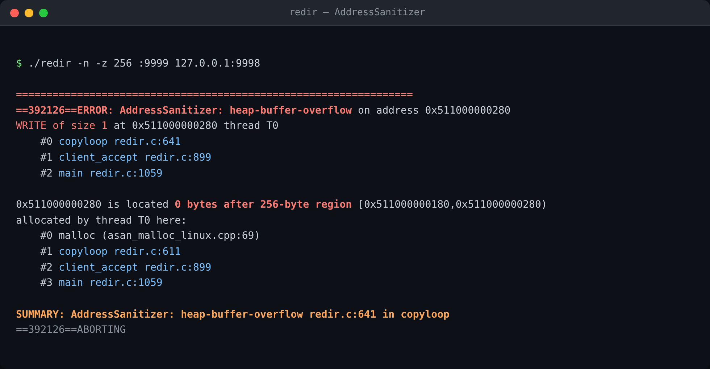

# How I Broke redir While Trying to Reproduce a Different CVE

| Field       | Value                                                                                                          |
|-------------|-----------------------------------------------------------------------------------------------------------------|
| Date        | 15/07/2026                                                                                                       |
| Description | Trying to reproduce CVE-2020-37182 in redir to practice binary exploitation, I found a different, undisclosed bug instead. |

I wanted to get better at binary exploitation. Not "read about it" better. Actually-pop-a-shell better. The plan was simple: pick a small, real CVE in a small, real C program, reproduce it, and use it as a training ground for stack layout, ASLR, canaries, the whole thing.

[redir](https://github.com/troglobit/redir) looked perfect. It's a tiny TCP port redirector, a few hundred lines of C, and it has an assigned CVE: **CVE-2020-37182**, a stack-based buffer overflow in `doproxyconnect()`.

I never got to exploit it. I found a different bug instead.

## The CVE I Was Actually Chasing

`doproxyconnect()` handles redir's `-x/--connect` option, which sends a `CONNECT` string to an upstream proxy before relaying traffic. In the vulnerable versions it looked like this:

```c
void doproxyconnect(int socket)
{
	char buf[128];

	sprintf((char *)&buf, "CONNECT %s HTTP/1.0\n\n", connect_str);
	...
}
```

`buf` is a fixed 128-byte stack buffer. `connect_str` comes straight from `-x` on the command line, with no length check anywhere. Hand `sprintf()` a long enough string and it keeps writing past `buf`, straight through the stack frame. Textbook stack smashing: canary, saved RBP, return address, all fair game if you control the length and content of `-x`.

That's exactly the kind of bug I wanted to cut my teeth on.

## The Dead End

I cloned the repo, built it with a sanitizer-enabled toolchain, and threw a long `-x` argument at it, expecting a crash I could start walking back from a core dump.

Nothing. No crash, no ASAN complaint, nothing.

So I went and read the current source instead of trusting the CVE description:

```c
void doproxyconnect(int socket)
{
	char buf[128];
	int rc;

	snprintf(buf, sizeof(buf), "CONNECT %s HTTP/1.0\n\n", connect_str);
	...
}
```

`sprintf()` had already been swapped for `snprintf()`, bounded to `sizeof(buf)`. Commit history confirmed it: fixed under `Fix #15: use snprintf() rather than sprintf()`, the same cleanup pass that closed out `CVE-2020-37182`. The version checked out was already patched. My training target was gone before I'd written a single payload.

## Poking Around Instead of Giving Up

Rather than switch projects, I kept the sanitizer build around and just started throwing traffic at redir the way it's meant to be used: as an actual TCP redirector, with a listener on one end and `nc` on the other, varying payload sizes and the `-z` buffer-size option along the way.

A little while in, one of those runs didn't behave like the others.

## Tooling

Nothing exotic. Deliberately boring tools, used carefully. In case anyone wants to repeat this:

**Build: autotools with sanitizers baked in at configure time**

```bash
git clone https://github.com/troglobit/redir
cd redir
./autogen.sh
./configure CC=gcc CFLAGS="-fsanitize=address,undefined -g"
make
```

`-fsanitize=address` (ASan) is what actually catches the out-of-bounds write, with a stack trace pointing at both the write and the original allocation. `-fsanitize=undefined` (UBSan) rides along for free. `-g` keeps debug symbols so the sanitizer's stack traces resolve to `file:line` instead of raw addresses.

**Run it in the foreground, not as a daemon**

`-n` keeps redir attached to the terminal instead of forking off and daemonizing. Sanitizer reports go to stderr; if redir detached, I'd never have seen the report land.

**Shrink the buffer to make iteration fast**

Default `bufsize` is `BUFSIZ` (8192 here). That works fine to trigger the bug, but during exploration I ran with `-z 256`: a smaller buffer means smaller, faster, easier-to-read payloads while I was still trying different message shapes and hadn't yet pinned down that the actual trigger condition was simply "a message of exactly `bufsize` bytes," nothing about its content.

**A dummy target on the other end**

```bash
nc -lp 9998
```

redir needs somewhere to forward the connection to. A bare `nc` listener is enough: it never has to respond, since the crash happens on the client-facing side of `copyloop()` before anything comes back from upstream.

**A client that controls the exact byte count**

This detail mattered more than anything else. `curl`, or `nc` used interactively, don't give precise control over how many bytes land in a single `write()`. The bug only fires when `read()` on redir's side returns *exactly* `bufsize` in one call, so I reached for a short Python one-liner instead:

```python
import socket
s = socket.socket()
s.connect(('127.0.0.1', 9999))
s.send(b'A' * 256)   # exactly bufsize bytes, one send() call
s.close()
```

A single `socket.send()` of exactly `bufsize` bytes over a loopback TCP connection reliably arrives as one `read()` on the other end at this size, which hits the boundary deterministically on every run.

## ASAN Had Something to Say

```bash
./redir -n -z 256 :9999 127.0.0.1:9998
python3 -c "import socket; s=socket.socket(); s.connect(('127.0.0.1',9999)); s.send(b'A'*256); s.close()"
```



Not the bug I went looking for. Not even in the same function. But a heap-buffer-overflow is a heap-buffer-overflow, so I went and looked at what actually happened at `redir.c:641`.

## The Actual Bug

`copyloop()` is the function that shuffles bytes between the client and the target socket, the core of what redir does. It allocates one working buffer for the whole session:

```c
buf = malloc(bufsize);                    // allocates exactly bufsize bytes (default: 8192)
...
bytes = read(insock, buf, bufsize);       // read() can return up to bufsize bytes
if (bytes <= 0)
    break;

buf[bytes] = 0;                           // when bytes == bufsize: writes to buf[bufsize]
                                           // → one byte past the allocated region
```

`malloc(bufsize)` reserves exactly `bufsize` bytes, valid indices `0` through `bufsize - 1`. `read()` is allowed to fill the buffer completely, i.e. return exactly `bufsize`. When that happens, `buf[bytes]` is `buf[bufsize]`, one byte past the end of the allocation.

Any client that connects and sends exactly `bufsize` bytes in one write (8192 by default, or whatever `-z` was set to) triggers the out-of-bounds write. No authentication, no special payload content, just the right length.

## Why It Slipped Through

This is the part that made it worth writing up. The bug isn't a case of nobody caring about memory safety. It's the opposite. It was *introduced* by a fix.

```c
// before, pre-2016
if ((bytes = read(insock, buf, bufsize)) <= 0)
	break;
```

Coverity Scan flagged this as passing a non-NUL-terminated buffer to `ftp_clean()`'s internal `strchr()`/`sscanf()` calls, a legitimate finding. The fix, applied the same day across both the inbound and outbound read paths, added the terminator:

```c
// after
bytes = read(insock, buf, bufsize);
if (bytes <= 0)
	break;

buf[bytes] = 0;   // <- new line, added to silence the Coverity warning
```

Correct instinct, incomplete fix. Writing a terminator after the data needs one more byte of storage than the data itself. The allocation never grew to match. A static analyzer caught an uninitialized/unterminated-string issue and, in the process of fixing it, planted a heap overflow that's been sitting in every release since, including the one I'd downloaded to chase a completely different CVE.

## ASan Says "Bug." Does Stock glibc Agree?

Once I had the finding written up, I ran into a question I should have asked before getting excited: does this actually *do* anything to a redir binary built the normal way, without a sanitizer? ASan and production glibc are not the same allocator, and it's worth being precise about what each one actually enforces.

Under `-fsanitize=address`, every `malloc(n)` gets exactly `n` bytes of addressable memory, with a poisoned "redzone" placed immediately after; any access to it traps instantly. That's by design: ASan is deliberately stricter than any real allocator, checking against the exact size the caller asked for, not whatever the allocator happens to hand back. That's documented in [Google's AddressSanitizer design notes](https://github.com/google/sanitizers/wiki/AddressSanitizerAlgorithm) and in the [original ASan paper (Serebryany et al., USENIX ATC 2012)](https://www.usenix.org/conference/atc12/technical-sessions/presentation/serebryany).

Real glibc doesn't work that way. `malloc()` rounds every request up to a 16-byte-aligned chunk and reserves 8 bytes for its own bookkeeping header, visible directly in [glibc's `request2size()` macro](https://github.com/bminor/glibc/blob/master/malloc/malloc.c). I checked this with `malloc_usable_size()` across a few sizes:

```
requested=  256  usable=  264  slack=  8
requested= 8192  usable= 8200  slack=  8
requested= 8200  usable= 8200  slack=  0   <- no slack
requested=  264  usable=  264  slack=  0   <- no slack
```

For any "round" `bufsize` (256, 512, 4096, 8192, anything already a multiple of 16), glibc silently hands back 8 bytes more than requested. `buf[bufsize] = 0` lands harmlessly in that padding. I rebuilt redir with a plain, unsanitized `gcc` and re-ran the exact same PoC against the default `bufsize` of 8192: no crash, nothing happened at all. ASan had correctly flagged undefined behavior; stock glibc simply absorbed it.

That's the thing I actually took away from this, more than the bug itself: **a sanitizer finding proves code violates its contract. It doesn't by itself prove a given deployment will misbehave.** Both can be true at once, and here they were. Our original PoC wasn't wrong; it was answering a narrower question than I initially assumed.

## But Some `-z` Values Aren't "Round"

The rounding only produces slack when `bufsize` is already a multiple of 16. Pick a value where `bufsize mod 16 == 8` instead (`-z 264`, `-z 8200`), and `malloc_usable_size()` returns exactly `bufsize`, no padding at all. I rebuilt redir unsanitized again, ran it with `-z 8200`, sent exactly 8200 bytes, and this time:

```
double free or corruption (!prev)
```

`SIGABRT`, confirmed with `coredumpctl`. A real crash on stock glibc, no instrumentation required. But only reachable if whoever runs redir happens to set `-z` to one of these specific "unlucky" values. Nobody picks `-z 8200` by instinct; it's not a power of two, not a round number, not the default. Possible, but not the default-configuration DoS the initial writeup implied.

## Would This Get You to RCE?

I checked, because a heap bug write-up that skips this question isn't finished. Short answer: no.

The `buf[bufsize] = 0` write, in the case where it does escape the chunk (`-z 8200`), lands on the low byte of the *next* chunk's size-and-flags word: for a fresh connection, that next chunk is redir's own top ("wilderness") chunk. Zeroing that byte clears the `PREV_INUSE` flag glibc uses to track whether the preceding chunk is still allocated. When `copyloop()` later calls `free(buf)`, glibc's `_int_free_merge_chunk()` checks exactly that bit on the following chunk before touching anything else:

```c
/* Or whether the block is actually not marked used.  */
if (__glibc_unlikely (!prev_inuse(nextchunk)))
  malloc_printerr ("double free or corruption (!prev)");
```
Source: [`malloc/malloc.c`, glibc source (mirror)](https://github.com/bminor/glibc/blob/master/malloc/malloc.c)

That check fires and aborts the process *before* any unlinking, consolidation, or use of attacker-influenced metadata takes place. It's exactly the kind of hardening glibc has carried for years to shut down classic heap-metadata exploitation techniques (see [how2heap](https://github.com/shellphish/how2heap) for what those attacks look like when the checks *aren't* in the way). There's no window between the corruption landing and the process dying for an attacker to do anything with it.

Even setting that check aside, redir's own code doesn't hand an attacker the pieces a heap exploit usually needs: one `malloc()` per connection, one `free()` at teardown, no further allocations in between to groom or reuse the corrupted metadata, and the process is a freshly forked child that exits immediately after. There's nothing left to build on.

So: a genuine memory-safety violation, a confirmed real crash under specific non-default configurations, and a hard ceiling at Denial of Service, not RCE.

## Impact

- **CWE-122**: Heap-based Buffer Overflow, one byte, NUL-only write.
- No authentication required to trigger the underlying write; any TCP client reaching redir's listening port that sends exactly `bufsize` bytes hits it.
- **Under default settings, no observable effect on a normally-compiled redir.** The chunk-size rounding absorbs the extra byte. The bug is real (confirmed by ASan/UBSan) but silent in the most common deployment.
- **Under specific non-default `bufsize` values (`bufsize mod 16 == 8`, e.g. `-z 8200`, `-z 264`)**, it's a confirmed, sanitizer-free crash on stock glibc (`double free or corruption (!prev)`, SIGABRT): real Denial of Service, but conditional on operator configuration.
- Not exploitable beyond DoS: glibc's own `_int_free` consistency checks abort before any attacker-controlled corruption can be leveraged, and redir's code path never performs the additional allocations a heap exploit would need to build on it.

The fix is one word:

```c
// redir.c:611
buf = malloc(bufsize + 1);
```

`read()` still consumes at most `bufsize` bytes, so `buf[bytes] = 0` always lands inside the allocation. I sent exactly this change upstream as [PR #47](https://github.com/troglobit/redir/pull/47), currently open and awaiting review from the maintainer.

## Where This Leaves Me

I still haven't popped a shell through `CVE-2020-37182`. That door was already closed by the time I got there. But I walked away with a real, upstream-reported bug nobody was looking for, and a reminder that's easy to forget when you're staring at a target CVE with tunnel vision: read the *current* source before you build your training exercise around it, and when a "defensive" commit adds a write, check whether it also added the byte to hold it.

A CVE request is pending; I'll update this post once one is assigned and PR #47 lands.
